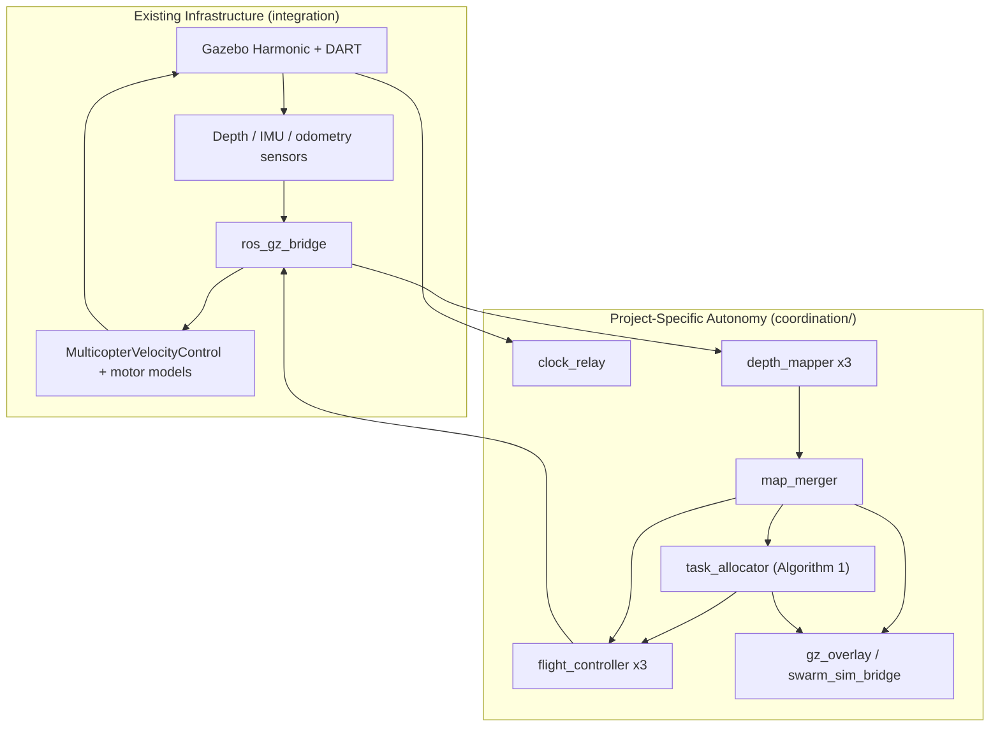
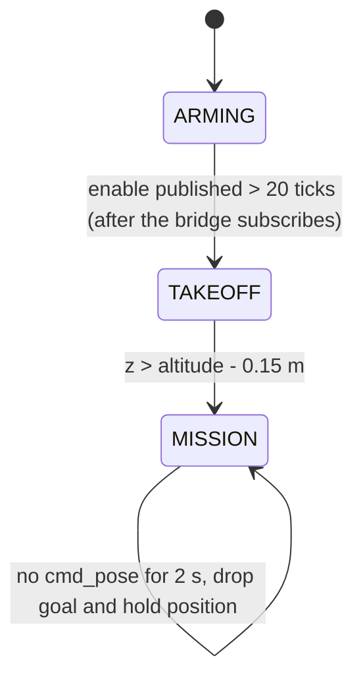

# System Architecture

> Scope: the running three-drone swarm in Gazebo Harmonic + ROS 2 Jazzy, flown by Gazebo's
> velocity controller with ground-truth odometry. Exact topic names, rates and parameters are in
> [`ros2-architecture.md`](ros2-architecture.md); the quick start is [`../README.md`](../README.md).
> The PX4 / VSLAM backend is future work (§11).

## 1. Two-Layer Architecture

The split between integration work and the project's own contribution still holds. The
infrastructure layer is existing tools wired together; the autonomy layer is the code this
project builds and owns.

### 1.1 Existing Infrastructure (integration layer)

* Gazebo Harmonic: world, DART physics, sensor rendering.
* Gazebo systems on each drone: `MulticopterMotorModel` (thrust and drag per propeller),
  `MulticopterVelocityControl` (velocity setpoint to rotor speeds), `OdometryPublisher`,
  `PosePublisher`, IMU, RGB and depth camera sensors.
* ROS 2 Jazzy (node graph) and `ros_gz_bridge` (Gazebo transport to ROS 2).
* RViz2 (optional).

### 1.2 Project-Specific Autonomy (contribution layer)

All in the Python package `coordination/`, with the maths in `coordination/algorithms.py`
(pure numpy, unit-tested by `coordination/test_swarm_coordination.py`):

* Per-drone depth mapping (`depth_mapper.py`)
* Conservative map merging and swarm metrics (`map_merger.py`)
* Frontier extraction, clustering and Algorithm 1 allocation (`task_allocator.py`)
* Path planning and velocity control (`flight_controller.py`)
* Simulation clock relay (`clock_relay.py`)
* Visualization: Gazebo overlay (`gz_overlay.py`) and RViz2 bridge (`swarm_sim_bridge.py`)
* Offline evaluation (`validation/`)



## 2. Major Components

| Component | Layer | Instances | Responsibility |
|---|---|---|---|
| `simple_world.sdf` | Infrastructure | 1 | Walled 24 m × 20 m arena (partitions, boxes, pillars), DART physics at a 2 ms step |
| `quadrotor_px4.sdf` | Infrastructure | 3 | Template rendered per drone (`__NS__`, `__COLOR__`, depth profile): 1.5 kg body, four rotors, sensors, velocity controller |
| `ros_gz_bridge` | Infrastructure | 1 (+1 with `rgb_bridge:=true`) | Bridges odometry, pose, IMU, depth image and camera info out; `cmd_vel` and `enable` in |
| `clock_relay` | Autonomy | 1 | Reads Gazebo `/clock` over gz-transport and republishes ROS `/clock` at ≤ 100 Hz |
| `depth_mapper` | Autonomy | 1 per drone | Depth image + odometry → log-odds local occupancy grid `/{ns}/map` |
| `map_merger` | Autonomy | 1 | Fuses local maps into `/global_map`; publishes coverage and overlap |
| `task_allocator` | Autonomy | 1 (central) | Frontier clusters → Algorithm 1 greedy no-overlap assignment → `/{ns}/cmd_pose` |
| `flight_controller` | Autonomy | 1 per drone | Arming, takeoff, A* on `/global_map`, pure pursuit, inter-drone separation → `/{ns}/cmd_vel` |
| `gz_overlay` | Visualization | 1 (GUI runs) | Draws merged map, frontiers, exclusion zones, paths, trails and gauges in the Gazebo window |
| `swarm_sim_bridge` | Visualization | 1 (`rviz:=true`) | TF `map → {ns}/base_link` and RViz2 drone / trail / environment markers |
| `validation/` | Evaluation | offline | Rosbag → CSV → ATE / coverage plots |

The allocator is centralized; mapping and flight control run per drone.

## 3. Launch Sequence

`run_gazebo_swarm.sh` sources ROS 2 Jazzy, builds `coordination` and `simulation` with colcon,
stops any stale `gz sim` process, then runs `ros2 launch simulation gazebo_swarm.launch.py`.
`run_single_window.sh` is the same with `rviz:=false`.

| Time | Action (from `gazebo_swarm.launch.py`) |
|---|---|
| t = 0 s | Gazebo server `gz sim -s -r --headless-rendering <world>`; `clock_relay`; `ros_gz_bridge` (and the RGB bridge if `rgb_bridge:=true`) |
| t = 3 s | `ros_gz_sim create` spawns `drone_1` (−4, −6), `drone_2` (0, −6), `drone_3` (4, −6) at z = 0.1 m, facing +y |
| t = 5 s | `coordination/launch/swarm_coordination.launch.py`: mappers, controllers, merger, allocator, plus `gz_overlay` (unless headless) and `swarm_sim_bridge` + RViz2 (if `rviz:=true`) |
| t = 7 s | Gazebo GUI client `gz sim -g --gui-config simulation/gui/swarm_gui.config` (skipped when `headless:=true`) |

The server and the GUI are separate processes, so drawing the 3D view never stalls physics.
Depth cameras are always rendered off-screen in the server (EGL).

## 4. Data Flow

```text
Gazebo (physics, 2 ms step)
   → depth camera (10 Hz realtime / 30 Hz full), odometry (30 Hz), IMU (200 Hz)
   → ros_gz_bridge
   → depth_mapper (per drone): rays → log-odds grid → /{ns}/map (2 Hz)
   → map_merger: conservative fusion → /global_map (2 Hz, latched)
   → task_allocator (1 Hz): frontiers → clusters → Algorithm 1 → /{ns}/cmd_pose (z = 1.5 m)
   → flight_controller (per drone): A* (1 Hz replan) → pure pursuit (20 Hz) → /{ns}/cmd_vel
   → ros_gz_bridge → MulticopterVelocityControl → rotor speeds
   → drone moves in Gazebo → new depth frames (loop)
```

IMU, `/{ns}/ground_truth_pose` and depth `camera_info` are bridged but no running node consumes
them; they are there for validation, the Docker smoke test and the future VIO backend.

## 5. Control Flow

There is no single exploration-manager node. Control is split between the per-drone flight
controller state machine and the central allocator cycle.

**Flight controller (per drone, 20 Hz):**



**Task allocator (1 Hz):**

```text
read /global_map and drone poses (only drones above 1.0 m are tasked)
   → frontier clusters (inside arena bounds, ≥ 0.4 m from mapped obstacles, ≥ 5 cells)
   → for each drone with a target: release on arrival (≤ 0.8 m),
     blacklist after 20 s without 0.5 m progress,
     drop after ≥ 5 s if no frontier cluster is left within 2.0 m of the target
   → greedy_assign() for drones that need a target (2.0 m exclusion, discounted gain)
   → publish every active target on /{ns}/cmd_pose
   → no clusters and no active targets: log EXPLORATION COMPLETE; drones hold position
```

## 6. Sensor Flow

```text
Gazebo sensors (server process, rendered via EGL)
   → gz topics /{ns}/depth/image, /{ns}/imu, /model/{ns}/odometry, /model/{ns}/pose
   → ros_gz_bridge → sensor_msgs/Image (32FC1), sensor_msgs/Imu,
                     nav_msgs/Odometry (/{ns}/odom), geometry_msgs/PoseStamped (/{ns}/ground_truth_pose)
   → depth_mapper (depth + odom), task_allocator / flight_controller / visualizers (odom)
```

`sensor_profile` sets the depth camera: `realtime` is 160×120 at 10 Hz (default, keeps a laptop
near real time), `full` is 320×240 at 30 Hz (GPU hosts). The mapper samples about 80 rays per
frame in both profiles. The 640×480 RGB camera is bridged only with `rgb_bridge:=true`.

## 7. Mapping Flow

```text
depth frame (5 Hz integration) + drone odometry
   → skip if drone is below 0.8 m
   → one 2D ray per sampled column: free space up to the nearest return between 0.3 m and 2.7 m height
   → drop returns closer than 0.35 m (own propellers) and within 0.6 m of a teammate
   → log-odds update on a 200 × 200, 0.2 m grid (origin −20, −20), range ≤ 8 m
   → /{ns}/map with values {−1, 0, 100}
   → map_merger: occupied if any drone ≥ 65; free only if every observer says free; else unknown
```

All drones share one grid geometry so the merger can fuse cell by cell. Details: [`mapping.md`](mapping.md).

## 8. Exploration Flow

```text
/global_map
   → frontier cells (free with an unknown 8-neighbour)
   → 8-connected clusters (≥ 5 cells); target = frontier cell closest to the centroid
   → U(f) = α·IG(f)·discount(f) − β·distance   (α = β = 1, IG = frontier length in m,
            discount from teammates within the 5 m sensor radius)
   → reject f within 2.0 m of another drone or another drone's locked target
   → assign best (drone, frontier) pair, lock it, repeat
```

Details: [`exploration.md`](exploration.md) and [`algorithms.md`](algorithms.md).

## 9. Flight Control

* The project does not run a flight stack. Gazebo's `MulticopterVelocityControl` (a Lee geometric
  controller) turns a body-frame `Twist` into rotor speeds for four `MulticopterMotorModel`
  propellers. Inertial and propeller constants follow the Gazebo X3 reference airframe.
* `flight_controller` publishes `/{ns}/enable` to arm the controller, then `/{ns}/cmd_vel`:
  altitude hold (P-gain, ±0.6 m/s), pure pursuit at ≤ 0.8 m/s with 0.8 m lookahead, yaw towards
  the direction of travel (translation is scaled down until the drone faces it, so the forward
  depth camera sees where it flies), and repulsion inside 1.5 m of another drone.
* A* runs on `/global_map` with obstacles inflated by 0.5 m; unknown cells are traversable at
  double cost.

## 10. Visualization and Deployment

* **Gazebo window (default):** `gz_overlay` sends GUI-only markers to the Gazebo GUI's
  `/marker_array` service. They are invisible to the depth cameras, so the overlay never feeds back
  into perception. Not started with `headless:=true`.
* **RViz2 (`rviz:=true`):** `swarm_sim_bridge` publishes TF and markers; config in
  `coordination/rviz/swarm_coordination.rviz`.
* **Hosts:** Ubuntu 24.04 native or WSL2 (about 0.6–0.75× real time on a laptop under WSL2, limited
  by software rendering of the depth cameras), or the cloud-GPU container (VirtualGL + TurboVNC +
  noVNC on port 6080, headless mode, `check-gpu`, `smoke-test`) described in
  [`../docker/sim/README.md`](../docker/sim/README.md). All nodes use simulation time, so
  behaviour does not depend on wall-clock speed.

## 11. Future Work: PX4 / VSLAM Backend

Material from the earlier single-drone phase that is still a valid plan but is **not wired into
the running stack**:

* **PX4 flight stack.** Replace `MulticopterVelocityControl` with PX4 SITL per drone, receiving
  offboard setpoints from ROS 2 (uXRCE-DDS or MAVROS). PX4 would then own arming, mode transitions
  and attitude/position control. Starting points: `simulation/launch/start_px4_sitl.sh`,
  `simulation/launch/start_px4_swarm.sh`, `src/control/` (C++ `px4_control_node`).
* **VSLAM / VIO localization.** Replace Gazebo odometry with a visual-inertial pose estimate so
  the stack is GPS-denied end to end, not just GPS-free. Starting points: `vslam/isaac_ros_vslam_realsense.py`
  (Isaac ROS Visual SLAM with IMU fusion, pose on `/{ns}/visual_slam/tracking/vo_pose_covariance`),
  `sim/isaac_ros_vslam.sh`, and `vslam/mavrospy.launch.py` (relays the VSLAM pose to PX4 EKF2 via
  MAVROS on hardware). The allocator already subscribes to `/{ns}/mavros/local_position/pose` as an
  alternative pose source.
* **Design rule carried over:** the mapping and exploration code should not need to know which
  pose source is active. Both sources must publish in the same `map` frame, so localization and
  exploration can still be debugged independently (see [`localization.md`](localization.md)).
* **Legacy C++ packages.** `src/mapping`, `src/exploration` and `src/localization` implement the
  single-drone pipeline from that phase. The Python `coordination` package replaces them in the
  running stack; they are not built by `run_gazebo_swarm.sh`.
