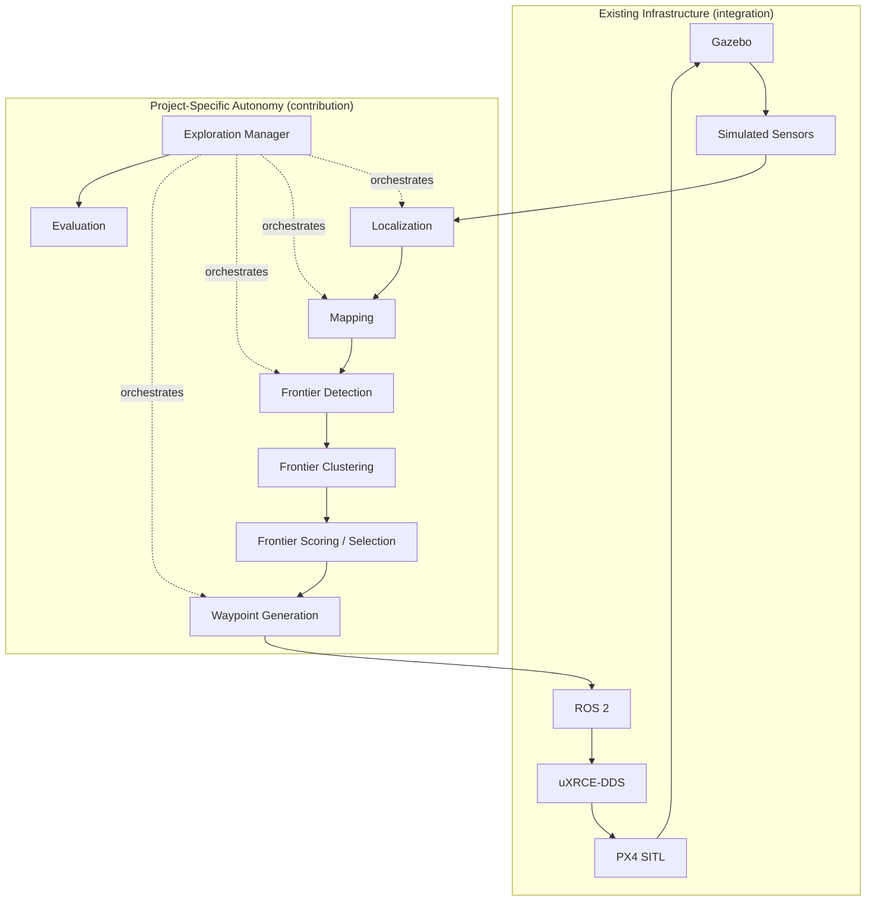
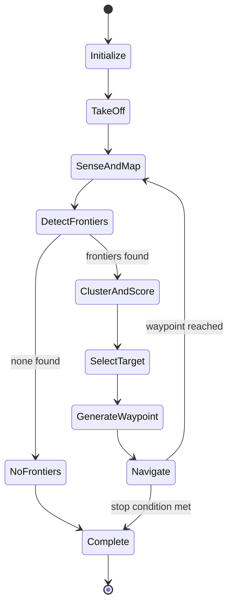

# System Architecture

> Scope: single simulated drone, software-only, GPS-denied exploration.
> No hardware, no swarm functionality. See
> [`development-roadmap.md`](development-roadmap.md) for the "Future Phase"
> swarm material, which is explicitly out of scope here.

## 1. Two-Layer Architecture

The project is split into two conceptual layers. Keeping this split explicit
matters because the two layers have very different risk profiles: the
infrastructure layer is mostly integration (getting existing tools to talk
to each other correctly), while the autonomy layer is the actual research
and engineering contribution of this project.

### 1.1 Existing Infrastructure (integration layer)

These are established tools being wired together, not built from scratch:

* Gazebo (simulation environment, physics, sensor simulation)
* PX4 SITL (flight controller, running in software-in-the-loop mode)
* ROS 2 (middleware / node graph)
* uXRCE-DDS (bridge between PX4's internal messaging and ROS 2/DDS)
* Sensor simulation (camera, IMU, depth, as provided by Gazebo)
* Flight control (PX4's own control loops — attitude, position control)

### 1.2 Project-Specific Autonomy (contribution layer)

This is the code this project actually builds and owns:

* Mapping (occupancy grid construction and maintenance)
* Frontier detection
* Frontier clustering
* Frontier scoring
* Frontier selection
* Waypoint generation
* Exploration manager (the state machine driving the loop)
* Evaluation tooling



## 2. Major Components

| Component | Layer | Responsibility |
|---|---|---|
| Gazebo world + drone model | Infrastructure | Physics, environment geometry, sensor simulation |
| PX4 SITL | Infrastructure | Low-level flight control, mode management |
| uXRCE-DDS agent/client | Infrastructure | Transport between PX4 uORB topics and ROS 2 |
| Localization node | Autonomy | Produces the drone's pose estimate (ground truth in early milestones, VSLAM/VIO later) |
| Mapping node | Autonomy | Maintains the occupancy grid from sensor + pose data |
| Frontier detector | Autonomy | Finds frontier cells in the occupancy grid |
| Frontier clustering | Autonomy | Groups frontier cells into candidate regions |
| Frontier selector | Autonomy | Scores clusters and picks the next exploration target |
| Waypoint generator | Autonomy | Converts a selected frontier into a safe, valid waypoint |
| Exploration manager | Autonomy | Drives the loop, tracks state, decides when exploration is complete |
| PX4 interface | Infrastructure/Autonomy boundary | Sends waypoints/setpoints to PX4 via ROS 2 offboard control |
| Evaluation scripts | Autonomy | Post-hoc and/or live metrics computation |

## 3. Data Flow

```text
Gazebo (world, physics)
   → Simulated sensors (camera, IMU, depth)
   → Localization (ground truth OR VSLAM/VIO)
   → Estimated pose
   → Mapping (occupancy grid update)
   → Frontier detection
   → Frontier clustering
   → Frontier scoring & selection
   → Waypoint generation
   → PX4 interface (ROS 2 offboard control)
   → PX4 SITL
   → Drone moves in Gazebo
   → (loop)
```

## 4. Control Flow

The **Exploration Manager** is the top-level state machine. It does not do
mapping or frontier math itself — it calls into the mapping and exploration
components and reacts to their outputs. A representative state sequence:



Stop conditions (coverage threshold, no frontiers, max time, max distance,
safety trigger) are described in [`exploration.md`](exploration.md) and must
be configurable, not hard-coded.

## 5. Sensor Flow

```text
Gazebo sensor plugins (camera, IMU, depth)
   → ROS 2 topics (sensor_msgs/Image, sensor_msgs/Imu, sensor_msgs/PointCloud2 or Image for depth)
   → Localization node (consumes camera+IMU for VSLAM/VIO; ground-truth mode bypasses this)
   → Mapping node (consumes depth/pointcloud + pose)
```

Exact topic names are version-dependent on the Gazebo/ROS 2/PX4 bridge
configuration in use and must be confirmed against
[`ros2-architecture.md`](ros2-architecture.md) rather than assumed.

## 6. Mapping Flow

```text
Depth/point-cloud observation + current pose estimate
   → Ray-cast or project observation into map frame
   → Mark cells FREE (observed empty space) / OCCUPIED (observed obstacle)
   → Cells never observed remain UNKNOWN
   → Publish updated occupancy grid (nav_msgs/OccupancyGrid or equivalent)
```

Full detail in [`mapping.md`](mapping.md).

## 7. Exploration Flow

```text
Occupancy grid
   → frontier cells (FREE adjacent to UNKNOWN)
   → clusters of connected frontier cells
   → per-cluster properties (size, centroid, distance from drone)
   → score = information_gain - distance_cost (initial model)
   → best-scoring cluster selected
   → representative point converted into a validated, obstacle-clear waypoint
```

Full detail in [`exploration.md`](exploration.md) and
[`algorithms.md`](algorithms.md).

## 8. PX4 Interaction

* ROS 2 nodes communicate with PX4 through uXRCE-DDS, not directly.
* Waypoints are sent using PX4's offboard control interface.
* The exploration stack does not implement low-level flight control (attitude
  control, motor mixing) — that remains inside PX4.
* Mode transitions (e.g., into/out of Offboard mode, arming, takeoff) must be
  handled explicitly and are part of the PX4 interface node's
  responsibility.

## 9. ROS 2 Interaction

* All autonomy components are ROS 2 nodes (C++) or make use of ROS 2 launch
  and configuration (Python).
* Nodes communicate via topics (streaming data: pose, map, frontiers) and
  may use services/actions for request/response interactions (e.g.,
  "navigate to waypoint and report completion").
* Full node/topic/message details are in
  [`ros2-architecture.md`](ros2-architecture.md); this file intentionally
  does not repeat exact interface signatures to avoid drift between
  documents.

## 10. What This Architecture Explicitly Excludes (Phase 1)

* Multiple drones, multi-agent coordination, task allocation.
* Any physical hardware or embedded deployment target.
* Databases, microservices, containers, or cloud services — none of the
  above are needed for a single-process simulation stack.
