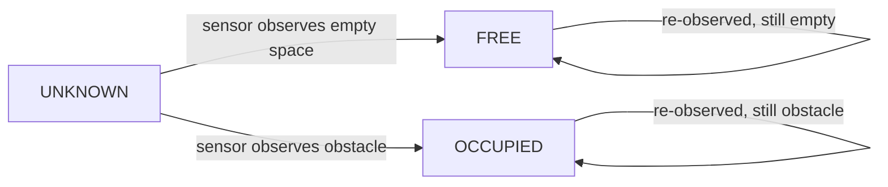

# Mapping

## 1. Occupancy Grid

The system uses a 2D occupancy grid as its primary map representation for
Phase 1. Each cell holds one of three states:

```text
UNKNOWN   — never observed
FREE      — observed as traversable, empty space
OCCUPIED  — observed as containing an obstacle
```



## 2. How Sensor Observations Update the Map

1. A depth/point-cloud observation arrives, associated with a timestamp.
2. The current pose estimate (from Localization, see
   [`localization.md`](localization.md)) at that timestamp is used to
   transform the observation from the sensor frame into the map frame.
3. For each observed point:
   * Cells between the sensor origin and the observed point (the line of
     sight) are marked/updated toward FREE, since the sensor "saw through"
     them.
   * The cell at the observed point itself is marked/updated toward
     OCCUPIED.
4. Cells never touched by any observation remain UNKNOWN.
5. Repeated observations of the same cell should reinforce its state
   (e.g., via a simple counter, log-odds update, or majority vote — exact
   method decided at M4 implementation time and recorded here once chosen).

Pseudocode:

```text
for each depth observation at time t:
    pose = get_pose_estimate(t)
    points_map_frame = transform(observation, pose)
    for point in points_map_frame:
        mark_free(ray_cells(sensor_origin(pose), point))
        mark_occupied(cell_at(point))
```

## 3. How the Drone Pose Relates to the Map

* The occupancy grid is expressed in the fixed **map frame**.
* Every incoming sensor observation must be transformed into the map frame
  using the pose estimate valid at the time the observation was captured.
* If pose and sensor data are not properly time-aligned, the map will smear
  or misplace obstacles — this is a common failure mode (see
  [`troubleshooting.md`](troubleshooting.md), "Map not updating" /
  coordinate-frame problems).

## 4. What the Map Frame Means

The map frame is a fixed, non-moving reference frame established at the
start of a run (conventionally where the drone begins, or a fixed world
origin). All frontier detection, clustering, scoring, and waypoint
generation happen in this frame. It is the same frame referenced in
[`system-design.md`](system-design.md) §6 and
[`localization.md`](localization.md) §7.

## 5. How Free Space Is Represented

A cell is FREE once sensor observations have shown it to be traversable
(i.e., the sensor's line of sight passed through it without hitting an
obstacle) with sufficient confidence (per whatever update rule is chosen at
M4 — e.g., a log-odds threshold).

## 6. How Obstacles Are Represented

A cell is OCCUPIED once a sensor observation has registered a surface/
obstacle at that cell's location with sufficient confidence. Obstacle cells
are what the waypoint generator's clearance check (see
[`exploration.md`](exploration.md) §"Waypoint generation") must respect.

## 7. How Unknown Space Is Represented

Any cell that has never been touched by a sensor observation remains
UNKNOWN. This is the state that frontier detection specifically looks for:
frontiers are FREE cells adjacent to UNKNOWN cells (see
[`exploration.md`](exploration.md)).

## 8. Why the Initial Frontier Algorithm Uses a 2D Representation

* Frontier-based exploration algorithms are simplest and best-understood in
  2D; starting there reduces the number of new problems introduced at once
  (consistent with the project's ground-truth-first, incremental-milestone
  philosophy).
* A 2D slice (e.g., at a fixed flight altitude, or a projection of a
  bounded altitude range) is sufficient to demonstrate the full
  sense-map-explore-navigate loop, which is the Phase-1 goal.
* This is a scope decision, not a claim that the world or the drone's
  motion is 2D — **the drone operates in a full 3D simulated environment**;
  only the exploration/mapping representation used for frontier decisions
  is 2D in Phase 1.

## 9. How This Can Later Be Extended Toward 3D Mapping

Documented here for direction only — not implemented in Phase 1:

* Replace the 2D occupancy grid with a 3D voxel representation (e.g., an
  octree-based structure), keeping the same UNKNOWN/FREE/OCCUPIED semantics
  per voxel instead of per cell.
* Frontier detection would generalize from "FREE cell adjacent to UNKNOWN
  cell" to "FREE voxel adjacent to UNKNOWN voxel," with clustering and
  scoring extended to 3D geometry (e.g., 3D connected-component clustering,
  distance cost in 3D).
* Waypoint generation would need a 3D clearance check instead of a 2D one.
* This extension should be introduced only after Phase 1 (single-drone,
  2D, GPS-denied exploration) is complete and evaluated, to avoid
  conflating a representation change with the core exploration-algorithm
  validation the project is built around.

## 10. Map Visualization in RViz2

* The occupancy grid should be visualized in RViz2 using a standard
  occupancy-grid display (e.g., `nav_msgs/OccupancyGrid`'s conventional
  color mapping: free space light, occupied dark, unknown gray/transparent
  — exact RViz2 display type to be confirmed once the concrete map message
  type is chosen at M4).
* Frontier cells/clusters and the currently selected waypoint should be
  overlaid as markers for debugging (useful from M5 onward).
* This visualization is a debugging aid; it is not itself part of the
  autonomy pipeline.
