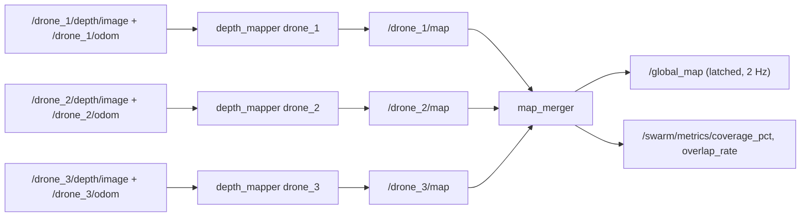

# Mapping

How the swarm turns depth images into a shared 2D occupancy grid. Every
formula lives in `coordination/algorithms.py` (pure numpy, unit-tested in
`coordination/test_swarm_coordination.py`) and is run by two ROS 2 nodes:

* `coordination/depth_mapper.py`: one instance per drone, builds the local map `/{ns}/map`.
* `coordination/map_merger.py`: one instance for the swarm, fuses the local maps into `/global_map`.

See [`../README.md`](../README.md) for the full system,
[`exploration.md`](exploration.md) for how the map is used, and
[`algorithms.md`](algorithms.md) for a compact per-algorithm reference.



## 1. Map Representation

All grids follow the `nav_msgs/OccupancyGrid` convention: row-major
(row = $y$, column = $x$), with three published values.

```text
-1   UNKNOWN   never observed (or evidence still inconclusive)
 0   FREE      observed as empty
100  OCCUPIED  observed as an obstacle
```

Every drone uses the same grid geometry, so the merger can fuse maps cell
by cell:

| Property | Value |
|---|---|
| Size | 200 × 200 cells |
| Resolution | 0.2 m (a 40 m × 40 m square) |
| Origin | $(-20, -20)$ m, frame `map` |
| Arena used for metrics | $x \in [-12, 12]$, $y \in [-9, 11]$ (24 m × 20 m) |

The map is a 2D slice at flight altitude. The drones fly in full 3D
physics, but only obstacles inside a height band (§3) are projected into
the grid. 2D keeps frontier detection, fusion and A* simple and is enough
for a single-floor arena.

## 2. Sensor

Each quadrotor (`simulation/models/quadrotor_px4.sdf`) carries a forward
RealSense-like depth camera, mounted 0.13 m ahead of `base_link`:

| Property | Value |
|---|---|
| Horizontal FOV | 1.5184 rad (87°) |
| Clip range | 0.1 – 20 m, metric `32FC1` depth |
| `sensor_profile:=realtime` (default) | 160 × 120 at 10 Hz |
| `sensor_profile:=full` | 320 × 240 at 30 Hz |

The mapper only trusts returns up to `max_range` = 8 m.

## 3. Depth Image to 2D Rays

`depth_image_to_rays()` converts one depth frame into one 2D ray per
sampled image column:

1. Sample pixels with a stride (auto: `width // 80`, i.e. about 80 columns
   per frame for both profiles) in both image axes.
2. Back-project each pixel with the pinhole model,
   $f_x = \frac{w/2}{\tan(\text{hfov}/2)}$, then transform it to the world
   frame with the camera offset and the drone's pose from `/{ns}/odom`.
3. Discard returns closer than `min_range` = 0.35 m (the drone's own
   propellers and airframe in view), non-positive returns, and returns at the
   far clip (no return).
4. A point is an obstacle if its world height lies in the band
   $0.3 \le z \le 2.7$ m. Lower points are floor; higher points are ceiling.
5. For each column, the **hit** is the obstacle point with the smallest
   horizontal range. Free space extends to the hit, or to 8 m when the
   column has no obstacle in range.
6. A column that saw only floor (no obstacle, no open view) is free only
   up to the farthest floor point it saw, so the mapper never invents free
   space beyond what it observed.

The ray azimuth comes from the column's viewing direction projected onto
the ground plane, so roll and pitch while flying are handled correctly.

## 4. Log-Odds Integration

`OccupancyLogOdds` keeps a float log-odds value $l(c)$ and an "observed"
flag per cell. For each frame:

* Cells along each ray, sampled every half cell (0.1 m) and stopping half a
  cell before the hit, get a free update.
* Hit cells get an occupied update and are removed from that frame's free set.
* Each cell is updated at most once per frame.

$$l(c) \leftarrow \operatorname{clip}\big(l(c) + \Delta,\ l_{\min},\ l_{\max}\big),
\qquad \Delta = \begin{cases} l_{\text{occ}} = +0.85 & \text{hit} \\ l_{\text{free}} = -0.4 & \text{pass-through} \end{cases}$$

with $l_{\min} = -2.0$ and $l_{\max} = 3.5$. Clamping keeps the map
responsive: a cell is never so certain that new evidence cannot flip it.
The published value is

$$M_i(c) = \begin{cases}
100 & \text{observed and } l(c) \ge 0.5 \\
0 & \text{observed and } l(c) \le -0.3 \\
-1 & \text{otherwise}
\end{cases}$$

A single hit (+0.85) or a single pass-through (−0.4) is therefore enough
for a cell to leave UNKNOWN. Cells with conflicting evidence that lands
between the two thresholds are published as UNKNOWN.

## 5. What Is Not Mapped

| Filter | Rule | Why |
|---|---|---|
| Own propellers | returns closer than 0.35 m are dropped | blades in view would become obstacles at the drone's own position |
| Teammates | hits within 0.6 m of another drone's odometry position are dropped (the ray still counts as free up to the teammate) | a moving drone is not a static obstacle |
| Take-off | frames are ignored while the drone is below 0.8 m | the camera would mostly see floor |
| Height band | points outside $0.3 \le z \le 2.7$ m are not obstacles | floor and ceiling are not walls |

The environment is otherwise assumed static. There is no other
dynamic-obstacle handling.

## 6. Rates

`depth_mapper` integrates the latest depth frame at 5 Hz (`update_rate`)
and publishes `/{ns}/map` at 2 Hz (`publish_rate`). It publishes nothing
until it has integrated at least one frame.

## 7. Conservative Map Merging

`map_merger` subscribes to every `/{ns}/map`, checks that each one matches
the geometry of the first map it received (mismatched maps are ignored with
a warning), and publishes the fused grid on `/global_map` at 2 Hz with
transient-local (latched) QoS. `fuse_occupancy()` applies:

$$M_{\text{global}}(c) = \begin{cases}
100 & \text{if } \exists i : M_i(c) \ge 65 \quad \text{(obstacle priority)} \\
0 & \text{if at least one drone observed } c \text{ and every drone that observed it reports } 0 \\
-1 & \text{otherwise}
\end{cases}$$

"Observed" means $M_i(c) \ge 0$. The rule is deliberately pessimistic:
an obstacle seen by any drone survives, and a cell is free only when no
observer disagrees. One drone is enough to declare a cell free. An
uncertain observer (a value from 1 to 64) keeps the cell UNKNOWN; the depth
mappers never publish such values, but other map sources could.

## 8. Swarm Metrics

Published by `map_merger` with every merge:

* **Coverage** (`/swarm/metrics/coverage_pct`): known cells (free or
  occupied) inside the arena bounds ÷ arena cells × 100 %.
* **Overlap rate** (`/swarm/metrics/overlap_rate`, only with ≥ 2 local
  maps): cells observed by ≥ 2 drones ÷ cells observed by ≥ 1 drone × 100 %.

$$\text{Coverage} = \frac{|\{c \in A : M_{\text{global}}(c) \ne -1\}|}{|A|} \times 100\%,
\qquad
\text{Overlap} = \frac{|\{c : n(c) \ge 2\}|}{|\{c : n(c) \ge 1\}|} \times 100\%$$

where $A$ is the set of arena cells and $n(c)$ the number of drones whose
local map has $M_i(c) \ge 0$. Overlap is high in practice (about 30–45 %
at 90 % coverage, see [`../README.md`](../README.md)): an 87° / 8 m camera
sees much of a 24 m × 20 m room from almost anywhere. Algorithm 1 keeps the
drones' targets and paths apart, not their fields of view.

## 9. Dependence on Pose

Every ray is placed using the drone's pose from `/{ns}/odom`, which is
currently Gazebo odometry (ground truth, see
[`localization.md`](localization.md)). The three local maps line up
because all drones share one exact world frame. With an estimated pose,
drift would smear walls in a drone's own map, and conservative fusion would
then keep misaligned walls from every drone as obstacles. That is safe but
lowers coverage and can close off doorways. The mapper also uses the latest
odometry message, not one time-aligned with the depth frame. That is fine
with 30 Hz exact odometry but must change with a drifting estimator.

## 10. Extending Toward 3D

Not implemented. A 3D version would replace the grid with a voxel map
(e.g. an octree) keeping the same UNKNOWN/FREE/OCCUPIED semantics,
generalize frontiers to free voxels next to unknown voxels, and plan in 3D.
The conservative fusion rule carries over unchanged per voxel.

## 11. Visualization

* **Gazebo window** (`coordination/gz_overlay.py`): free tiles in each
  drone's colour, white tiles for cells seen by 2 or more drones, red tiles
  for obstacles, plus coverage and overlap bars.
* **RViz2** (`rviz:=true`): `/global_map` and each `/{ns}/map` as
  `OccupancyGrid` displays.

## 12. Earlier Implementation

`src/mapping` (C++ `mapping_node` / `occupancy_map`) is from the earlier
single-drone phase. It is not built or launched by the current launcher;
the Python nodes above replace it.
