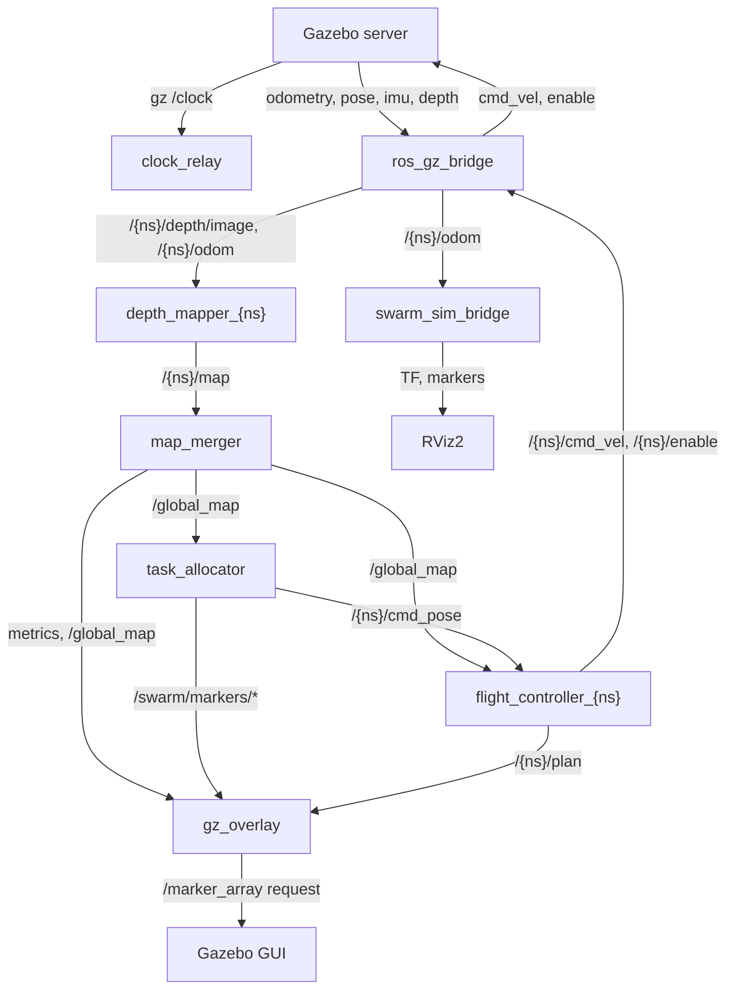

# ROS 2 Architecture

> ROS 2 Jazzy + Gazebo Harmonic via `ros_gz_bridge`. Every name, rate and default below is taken
> from `simulation/launch/gazebo_swarm.launch.py`, `coordination/launch/swarm_coordination.launch.py`
> and the node sources in `coordination/`. `{ns}` is `drone_1`, `drone_2` or `drone_3`. The
> earlier PX4 / uXRCE-DDS interface is in §8 as future work.

## 1. Node Graph



`/{ns}/odom` also goes to `task_allocator`, every `flight_controller` (own pose and teammates),
every `depth_mapper` (teammate filtering) and `gz_overlay`. All nodes run with `use_sim_time: true`.

## 2. Nodes

| Node | Executable | Instances | Started when |
|---|---|---|---|
| `ros_gz_bridge` | `ros_gz_bridge/parameter_bridge` | 1 | always |
| `ros_gz_camera_bridge` | `ros_gz_bridge/parameter_bridge` | 1 | `rgb_bridge:=true` |
| `clock_relay` | `coordination/clock_relay` | 1 | always |
| `spawn_{ns}` | `ros_gz_sim/create` | 3 | t = 3 s (exits after spawning) |
| `depth_mapper_{ns}` | `coordination/depth_mapper` | 3 | t = 5 s |
| `flight_controller_{ns}` | `coordination/flight_controller` | 3 | t = 5 s |
| `map_merger` | `coordination/map_merger` | 1 | t = 5 s |
| `task_allocator` | `coordination/task_allocator` | 1 | t = 5 s |
| `gz_overlay` | `coordination/gz_overlay` | 1 | t = 5 s, unless `headless:=true` |
| `swarm_sim_bridge` | `coordination/swarm_sim_bridge` | 1 | t = 5 s, `rviz:=true` |
| `rviz2_swarm` | `rviz2` (`coordination/rviz/swarm_coordination.rviz`) | 1 | t = 5 s, `rviz:=true` |

The Gazebo server (`gz sim -s -r --headless-rendering`) and GUI client (`gz sim -g`, t = 7 s,
skipped with `headless:=true`) are plain processes, not ROS nodes.

### 2.1 depth_mapper
* **In:** `/{ns}/depth/image` (32FC1, sensor-data QoS), `/{ns}/odom`, teammates' `/{other}/odom`.
* **Out:** `/{ns}/map`.
* **Parameters:** `grid_size` 200, `resolution` 0.2, `origin` [−20, −20], `horizontal_fov` 1.5184,
  `camera_offset` [0.13, 0, 0], `max_range` 8.0, `min_range` 0.35, `obstacle_z_min` 0.3,
  `obstacle_z_max` 2.7, `pixel_stride` 0 (auto, about 80 rays), `min_mapping_altitude` 0.8,
  `teammate_radius` 0.6, `update_rate` 5.0, `publish_rate` 2.0.

### 2.2 map_merger
* **In:** `/{ns}/map` for each drone.
* **Out:** `/global_map` (latched), `/swarm/metrics/coverage_pct`, `/swarm/metrics/overlap_rate`
  (overlap only once two or more local maps have arrived).
* **Parameters:** `publish_rate` 2.0 (launch argument of the coordination launch file),
  `global_frame_id` `map`, `arena_bounds` [−12, 12, −9, 11] (coverage denominator).

### 2.3 task_allocator
* **In:** `/global_map`, `/{ns}/odom`, and `/{ns}/mavros/local_position/pose` (hardware/PX4 hook,
  unused in simulation).
* **Out:** `/{ns}/cmd_pose` (z = `target_altitude`), `/swarm/markers/frontiers`,
  `/swarm/markers/locked_regions`.
* **Parameters:** `allocation_frequency` 1.0, `lock_radius` 2.0, `arrival_radius` 0.8,
  `min_cluster_size` 5, `target_altitude` 1.5, `alpha` 1.0, `beta` 1.0, `min_flight_altitude` 1.0,
  `progress_timeout` 20.0, `blacklist_radius` 1.0, `arena_bounds` [−12, 12, −9, 11],
  `obstacle_clearance` 0.4, `sensor_radius` 5.0, `min_commit_time` 5.0.

### 2.4 flight_controller
* **In:** `/{ns}/odom`, `/{ns}/cmd_pose`, `/global_map`, teammates' `/{other}/odom`.
* **Out:** `/{ns}/cmd_vel`, `/{ns}/enable`, `/{ns}/plan`.
* **Parameters:** `altitude` 1.5, `cruise_speed` 0.8, `max_yaw_rate` 0.8, `lookahead` 0.8,
  `inflation_radius` 0.5, `separation_radius` 1.5, `control_rate` 20.0, `replan_rate` 1.0,
  `command_timeout` 2.0.
* **States:** ARMING → TAKEOFF → MISSION (see [`architecture.md`](architecture.md) §5).

### 2.5 clock_relay
* Subscribes to Gazebo `/clock` over gz-transport (Gazebo publishes it every 2 ms physics step,
  i.e. 500 Hz) and republishes ROS `/clock` (reliable QoS) at most `max_rate` (100 Hz). Bridging
  the raw 500 Hz clock would wake every sim-time node 500 times a second and slow Gazebo down.
* **Parameters:** `gz_topic` `/clock`, `max_rate` 100.0.

### 2.6 gz_overlay
* **In:** `/global_map`, `/{ns}/map`, `/{ns}/odom`, `/{ns}/plan`, `/swarm/markers/frontiers`,
  `/swarm/markers/locked_regions`, both metrics topics.
* **Out:** GUI-only Gazebo markers via a gz-transport request to `/marker_array` (served by the GUI's
  MarkerManager plugin). Waits if no GUI is running.
* **Parameters:** `map_rate` 0.5, `dynamic_rate` 1.0, `hud_position` [0, 11.6, 3.6], `trail_length` 400.

### 2.7 swarm_sim_bridge
* **In:** `/{ns}/odom`, the world SDF (`world_file`).
* **Out:** TF `map → {ns}/base_link`, `/swarm/markers/drones`, `/swarm/markers/trails`,
  `/swarm/markers/environment` (latched; walls and obstacles parsed from the SDF).
* **Parameters:** `world_file`, `trail_length` 600.

## 3. Topics

| Topic | Type | Rate | Publisher |
|---|---|---|---|
| `/clock` | `rosgraph_msgs/Clock` | ≤ 100 Hz | `clock_relay` |
| `/{ns}/odom` | `nav_msgs/Odometry` (frame `map`) | 30 Hz | bridge (from `/model/{ns}/odometry`) |
| `/{ns}/ground_truth_pose` | `geometry_msgs/PoseStamped` | 30 Hz | bridge (from `/model/{ns}/pose`) |
| `/{ns}/imu` | `sensor_msgs/Imu` | 200 Hz | bridge |
| `/{ns}/depth/image` | `sensor_msgs/Image` (32FC1, 0.1–20 m) | 10 Hz `realtime` / 30 Hz `full` | bridge |
| `/{ns}/depth/camera_info` | `sensor_msgs/CameraInfo` | with depth | bridge |
| `/{ns}/camera/image` | `sensor_msgs/Image` (640×480) | 30 Hz | camera bridge (`rgb_bridge:=true`) |
| `/{ns}/map` | `nav_msgs/OccupancyGrid` (200×200, 0.2 m) | 2 Hz | `depth_mapper` |
| `/global_map` | `nav_msgs/OccupancyGrid` (transient local) | 2 Hz | `map_merger` |
| `/swarm/metrics/coverage_pct` | `std_msgs/Float32` | 2 Hz | `map_merger` |
| `/swarm/metrics/overlap_rate` | `std_msgs/Float32` | 2 Hz | `map_merger` |
| `/{ns}/cmd_pose` | `geometry_msgs/PoseStamped` | 1 Hz | `task_allocator` |
| `/swarm/markers/frontiers`, `/swarm/markers/locked_regions` | `visualization_msgs/MarkerArray` | 1 Hz | `task_allocator` |
| `/{ns}/plan` | `nav_msgs/Path` | 1 Hz (and on goal change) | `flight_controller` |
| `/{ns}/cmd_vel` | `geometry_msgs/Twist` (body frame) | 20 Hz | `flight_controller` |
| `/{ns}/enable` | `std_msgs/Bool` | 20 Hz while arming / taking off | `flight_controller` |
| `/swarm/markers/drones`, `/swarm/markers/trails`, `/swarm/markers/environment` | `visualization_msgs/MarkerArray` | — | `swarm_sim_bridge` |

QoS: `/global_map` is published and subscribed with `TRANSIENT_LOCAL` depth 1 (latched), so late
subscribers get the last map. `depth_mapper` subscribes to depth with `qos_profile_sensor_data`.
Other topics use reliable QoS (depth 10 for most publishers).

There are no services or actions in the running stack.

## 4. Gazebo ↔ ROS 2 Bridge

`ros_gz_bridge parameter_bridge` arguments per drone (`[` = Gazebo → ROS, `]` = ROS → Gazebo):

```text
/model/{ns}/odometry@nav_msgs/msg/Odometry[gz.msgs.Odometry        → remapped to /{ns}/odom
/model/{ns}/pose@geometry_msgs/msg/PoseStamped[gz.msgs.Pose        → remapped to /{ns}/ground_truth_pose
/{ns}/imu@sensor_msgs/msg/Imu[gz.msgs.IMU
/{ns}/depth/image@sensor_msgs/msg/Image[gz.msgs.Image
/{ns}/depth/camera_info@sensor_msgs/msg/CameraInfo[gz.msgs.CameraInfo
/{ns}/cmd_vel@geometry_msgs/msg/Twist]gz.msgs.Twist
/{ns}/enable@std_msgs/msg/Bool]gz.msgs.Boolean
```

`/clock` is deliberately not bridged (see §2.5). The RGB topics run in a separate bridge node
because once bridged, Gazebo renders all three 640×480 cameras at 30 Hz.

## 5. Launch Arguments

`ros2 launch simulation gazebo_swarm.launch.py` (also accepted by `run_gazebo_swarm.sh` /
`run_single_window.sh` and their `.ps1` wrappers):

| Argument | Default | Effect |
|---|---|---|
| `world` | `simulation/worlds/simple_world.sdf` (installed share path) | World SDF; also mirrored into RViz2 |
| `headless` | `false` | No Gazebo GUI client and no `gz_overlay` |
| `rviz` | `false` | Start `swarm_sim_bridge` and RViz2 |
| `sensor_profile` | `realtime` | `realtime` = 160×120 depth at 10 Hz; `full` = 320×240 at 30 Hz |
| `rgb_bridge` | `false` | Bridge `/{ns}/camera/image` |
| `lock_radius` | `2.0` | Algorithm 1 exclusion radius (m) |
| `altitude` | `1.5` | Flight and target altitude (m) |

`coordination/launch/swarm_coordination.launch.py` can also be launched on its own (with Gazebo
already running). It adds `use_sim_time` (true), `gz_overlay` (false), `publish_rate` (2.0),
`drones` (`drone_1,drone_2,drone_3`) and `world_file`; note its own `rviz` default is `true`.

## 6. Frames and TF

Odometry, maps, goals, paths and markers are all in `map`. TF `map → {ns}/base_link` comes only
from `swarm_sim_bridge` (`rviz:=true`); no autonomy node uses TF. See
[`system-design.md`](system-design.md) §6.

## 7. Packages

| Package | Build | Contents |
|---|---|---|
| `simulation` | CMake (ament) | World, drone model template, GUI config, launch files |
| `coordination` | Python (ament_python) | The nodes above, `algorithms.py`, launch, RViz config |
| `src/control`, `src/exploration`, `src/localization`, `src/mapping` | CMake | Earlier single-drone C++ packages; **not built** by `run_gazebo_swarm.sh`, which runs `colcon build --packages-select coordination simulation` (`src/control` and `src/localization` also need `px4_msgs` / `gazebo_ros`) |

## 8. Future Work: PX4 / VSLAM Backend

Kept from the single-drone PX4 design as the plan for replacing Gazebo's velocity controller and
ground-truth odometry. None of this is wired into the running launch files.

**PX4 interface node (replaces `MulticopterVelocityControl` as the flight stack).**
* Purpose: turn `/{ns}/cmd_pose` (or the flight controller's velocity output) into PX4 offboard
  setpoints, manage arming, offboard mode, takeoff and landing, and report arrival.
* Transport: uXRCE-DDS (PX4 uORB topics bridged into ROS 2 by the Micro XRCE-DDS Agent) or MAVROS
  (`vslam/mavrospy.launch.py` already uses MAVROS for hardware).
* Starting points: `src/control/` (`px4_control_node.cpp`), `simulation/launch/start_px4_sitl.sh`,
  `simulation/launch/start_px4_swarm.sh`.
* **VERSION-DEPENDENT, confirm against the installed PX4 before implementing:** `px4_msgs`
  definitions and bridged topic names, the uXRCE-DDS topic-mapping configuration, and the minimum
  offboard setpoint rate PX4 needs to stay in offboard mode. The existing `src/control` code was
  written against ROS 2 Humble and would need porting to Jazzy.

**VSLAM / VIO localization node.**
* Purpose: publish each drone's pose in the `map` frame from camera + IMU, so the stack no longer
  uses ground truth. The output must match what mapping and allocation consume today
  (`/{ns}/odom`-equivalent pose), keeping them pose-source-agnostic.
* Starting point: `vslam/isaac_ros_vslam_realsense.py` (Isaac ROS Visual SLAM with IMU fusion,
  publishes `/{ns}/visual_slam/tracking/vo_pose_covariance`) and `sim/isaac_ros_vslam.sh`. In
  simulation the inputs would be the bridged `/{ns}/imu` (200 Hz) and camera streams.
* Evaluation: `/{ns}/ground_truth_pose` stays as the reference for ATE in `validation/`.
