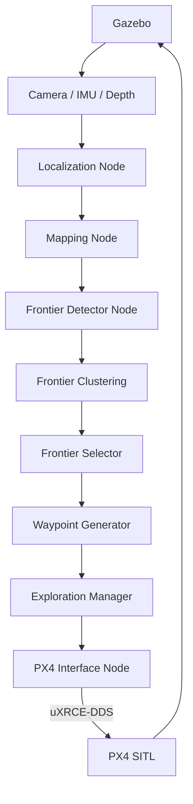

# ROS 2 Architecture

> **Note on exact interface names:** PX4's ROS 2 topic names and message
> types (e.g., under `px4_msgs`) vary between PX4 and `px4_ros_com`/
> `px4_msgs` releases, and the uXRCE-DDS topic mapping is configured per
> installation. This document defines the **node graph and responsibilities**
> precisely, and marks anything that depends on the exact installed
> PX4/ROS 2 version as **VERSION-DEPENDENT — confirm against the installed
> PX4/uXRCE-DDS version before implementing.**

## 1. Conceptual Node Graph

The **Exploration Manager** also has bidirectional connections (not drawn
above for clarity) to most nodes for orchestration: it triggers each stage,
receives completion/failure signals, and enforces the stop condition.

## 2. Node Responsibilities

### 2.1 Localization Node
* **Purpose:** Produce the drone's pose estimate in the map frame.
* **Inputs:** Camera image, IMU data (VSLAM/VIO mode); OR Gazebo ground-truth
  pose topic (development mode, pre-M11).
* **Outputs:** Pose estimate (position + orientation) on a single documented
  topic, regardless of which mode is active — this is what lets mapping and
  exploration code be pose-source-agnostic (see
  [`localization.md`](localization.md)).
* **Parameters:** Mode selector (ground_truth vs. vslam), VSLAM
  configuration (candidate: ORB-SLAM3 parameters) if applicable.
  **VERSION-DEPENDENT** on chosen VSLAM library's ROS 2 integration.
* **Dependencies:** Gazebo ground-truth topic (dev mode) or camera+IMU
  topics (target mode).
* **Update frequency:** Should match or exceed IMU rate for VIO stability
  (typically 100+ Hz for IMU-driven prediction, lower for vision updates);
  exact target rate to be set once M3/M11 are implemented.

### 2.2 Mapping Node
* **Purpose:** Maintain the 2D occupancy grid.
* **Inputs:** Pose estimate (from Localization Node), depth/point-cloud
  data (from simulated sensors).
* **Outputs:** Occupancy grid (candidate: `nav_msgs/OccupancyGrid` or a
  project-specific equivalent message).
* **Parameters:** Cell resolution, map bounds/size, update policy.
* **Dependencies:** Localization Node, depth sensor topic.
* **Update frequency:** Driven by depth sensor rate; does not need to match
  IMU rate.

### 2.3 Frontier Detector Node
* **Purpose:** Identify frontier cells in the current occupancy grid.
* **Inputs:** Occupancy grid.
* **Outputs:** List of frontier cells (candidate: custom message
  `FrontierCells` or similar — to be defined at M5).
* **Parameters:** None required initially; may later add a minimum
  frontier-cell threshold.
* **Dependencies:** Mapping Node.
* **Update frequency:** Triggered by map updates or on a fixed timer;
  decision deferred to M5 implementation.

### 2.4 Frontier Clustering
* **Purpose:** Group connected frontier cells into candidate regions.
* **Inputs:** Frontier cell list.
* **Outputs:** List of clusters, each with member cells, centroid, and size.
* **Parameters:** Connectivity type (4- vs 8-connected), minimum cluster
  size.
* **Dependencies:** Frontier Detector Node.
* **Update frequency:** Same cadence as Frontier Detector output.

### 2.5 Frontier Selector
* **Purpose:** Score clusters and pick the best exploration target.
* **Inputs:** Cluster list, current pose estimate.
* **Outputs:** Selected target (cluster or representative point).
* **Parameters:** Scoring weights (information-gain weight, distance-cost
  weight); scoring function must be swappable per NFR-3 in
  [`system-design.md`](system-design.md).
* **Dependencies:** Frontier Clustering, Localization Node.
* **Update frequency:** On each new cluster list, or as requested by the
  Exploration Manager.

### 2.6 Waypoint Generator
* **Purpose:** Convert a selected frontier target into a validated,
  obstacle-clear waypoint in a documented coordinate frame.
* **Inputs:** Selected target, occupancy grid (for validity/clearance
  checks).
* **Outputs:** Validated waypoint (position + frame).
* **Parameters:** Minimum obstacle clearance, coordinate frame to publish
  in.
* **Dependencies:** Frontier Selector, Mapping Node.
* **Update frequency:** On each new target selection.

### 2.7 Exploration Manager
* **Purpose:** Orchestrate the full loop and enforce the stop condition.
* **Inputs:** Status/output from every autonomy node above; waypoint
  arrival confirmation from PX4 Interface Node.
* **Outputs:** Trigger/enable signals to other nodes; exploration-complete
  signal.
* **Parameters:** Stop-condition thresholds (coverage %, max time, max
  distance), retry policy.
* **Dependencies:** All other autonomy nodes.
* **Update frequency:** Event-driven, reacting to each stage's completion.

### 2.8 PX4 Interface Node
* **Purpose:** Translate validated waypoints into PX4 offboard setpoints,
  manage mode transitions (arm, offboard, takeoff/land), and report
  waypoint arrival back to the Exploration Manager.
* **Inputs:** Validated waypoint, PX4 state/telemetry (via uXRCE-DDS).
* **Outputs:** Offboard setpoints to PX4; waypoint-arrival status.
* **Parameters:** Arrival tolerance, offboard setpoint rate (PX4 requires a
  minimum setpoint streaming rate to remain in offboard mode —
  **VERSION-DEPENDENT**, confirm current PX4 requirement).
* **Dependencies:** uXRCE-DDS bridge, Waypoint Generator (indirectly, via
  Exploration Manager).
* **Update frequency:** Must meet PX4's minimum offboard setpoint rate
  requirement — **VERSION-DEPENDENT**, confirm against installed PX4
  version at implementation time (commonly on the order of 2 Hz minimum
  historically, but this must be re-verified, not assumed).

## 3. Topics, Messages, and Parameters

Exact topic names and message types are **not fixed by this document**
because they depend on:

* The installed PX4 release's `px4_msgs` definitions.
* The uXRCE-DDS topic-mapping YAML configuration in use.
* Decisions made at each milestone about custom message types for
  frontier/cluster data.

**Confirmed (framework-level, unlikely to change):**
* ROS 2 Humble uses standard `rclcpp`/`rclpy` node, topic, service, and
  action mechanisms.
* Sensor data uses standard `sensor_msgs` types (`Image`, `Imu`,
  `PointCloud2`).
* Mapping likely uses `nav_msgs/OccupancyGrid` or a close analogue.

**VERSION-DEPENDENT — confirm before implementing:**
* Exact PX4 uORB topic names as bridged through uXRCE-DDS (e.g., vehicle
  odometry, vehicle command, offboard control mode topics).
* `px4_msgs` message definitions and field names for the installed PX4
  version.
* Minimum offboard setpoint streaming rate required by PX4 to remain in
  offboard mode.
* Whether frontier/cluster data is passed as custom ROS 2 messages or kept
  in-process within a combined exploration node — to be decided at M5/M6
  and recorded here once decided.

## 4. Services / Actions

Not required for the core streaming pipeline (topics suffice for pose, map,
frontier, and waypoint data). A ROS 2 action is a natural fit for
"navigate to waypoint and report completion/failure" (M9) given its
long-running, cancelable, feedback-producing nature; this should be decided
and documented concretely at M9 rather than assumed here.

## 5. ROS 2 ↔ PX4 Communication and the Role of uXRCE-DDS

* PX4 SITL exposes its internal uORB messaging bus.
* The uXRCE-DDS client (running inside/alongside PX4) and the uXRCE-DDS
  agent (running on the ROS 2 side) bridge uORB topics into the ROS 2/DDS
  graph, and vice versa for commands sent from ROS 2 to PX4.
* This means ROS 2 nodes never talk to PX4 directly — everything goes
  through the uXRCE-DDS bridge, and the set of topics available on the ROS 2
  side is defined by the uXRCE-DDS topic-mapping configuration, not by ROS 2
  or PX4 alone.
* This bridge, its configuration file, and the exact bridged topic set are
  **VERSION-DEPENDENT** and must be verified against the installed PX4 and
  Micro XRCE-DDS Agent versions at M2 implementation time.
